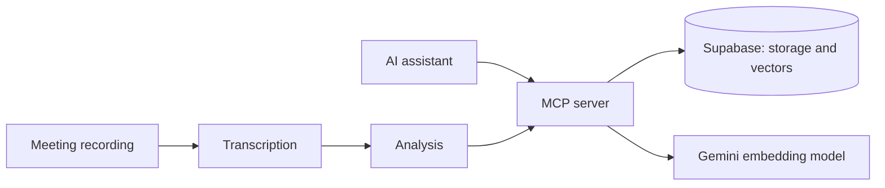

# knowledge-graph-mcp

An internal corporate knowledge base exposed to AI assistants through an MCP server. Status: solo pilot.

Source is private; this repo documents the architecture.

## What it is

A knowledge graph of nodes (facts, decisions, notes) with sources and evidence attached. AI assistants query and update it through MCP tools instead of through pasted context. Self-hosted.

## Why MCP

MCP gives any compatible assistant the same set of tools with typed inputs. The knowledge base stays in one place, and the assistant asks for what it needs instead of being given everything.

## Architecture

Embeddings come from a Gemini embedding model and are stored as vectors in Supabase.

## Tool groups

**Search**
- Search knowledge.

**Read**
- Fetch a node.
- Fetch related nodes.
- List sources.
- List the evidence behind a node.

**Write**
- Capture an insight.
- Add a project note.

**Ingestion**
- Meeting recordings are transcribed, analysed, and ingested as nodes with reviewable evidence.

## Status

Solo pilot. Used by one person.

## Stack

MCP server, Supabase (storage and vectors), Gemini embeddings, self-hosted.

<!-- TODO: screenshot of an assistant using the tools -->
